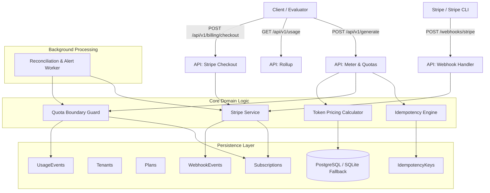

# System Map: Usage Metering & Billing Engine

## Active Modules & Responsibilities
- `config/settings.py`: Pydantic settings loading `.env` with validation.
- `config/pricing.json`: Pinned pricing constants (token rates in micro-cents).
- `src/db/`: SQLAlchemy async engine and multi-tenant isolated models.
- `src/core/calculator.py`: Lossless integer token pricing & `ROUND_HALF_UP_AT_INVOICE`.
- `src/core/idempotency.py`: Atomic SHA-256 payload deduplication & cached response replay.
- `src/core/quota.py`: Pre-execution boundary checks with row-level locking (429 vs 402).
- `src/core/stripe_service.py`: Stripe Checkout session creation & webhook verification/replay defense.
- `src/workers/reconciliation.py`: Background sync for missed webhooks & threshold alerts ($\ge 80\%$, $\ge 100\%$).
- `scripts/seed.py`: Deterministic test fixtures for evaluator acceptance probes.
