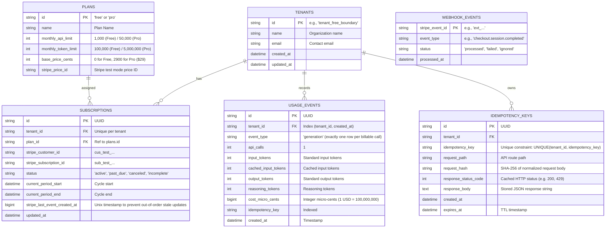

# Design Document: Usage Metering & Billing Engine

- **Author**: Antigravity & Engineer
- **Date**: 2026-10-20
- **Status**: Validated Design (Ready for Review & Planning)
- **Target Repo**: `llm-usage-metering-billing` (FlyRank Backend Track Capstone)

---

## 1. Executive Summary & Mission

Every SaaS product must reliably answer three fundamental questions:
1. **How much has this customer used?** (Usage Metering)
2. **How much should they pay?** (Money Math & Cost Calculation)
3. **Have they reached their plan limits?** (Quota Enforcement)

This service provides an idempotent, multi-tenant backend engine that meters billable events (API calls and simulated AI tokens), enforces plan quotas at strict numerical boundaries (yielding `429 Too Many Requests` or `402 Payment Required`), executes accurate integer-based token cost calculations, synchronizes subscription state via Stripe test mode webhooks with signature verification and replay protection, and runs a background reconciliation and quota alert worker.

---

## 2. Explicit Non-Goals (Scope Boundaries)

To ensure zero-risk correctness and respect capstone constraints:
- **No Real Payments or Live Mode**: The system operates strictly within Stripe Test Mode using test card numbers (e.g. `4242 4242 4242 4242`).
- **No Live External AI API Calls**: Token counts are metered and simulated via payload metadata; no external LLM API key or paid credit is required.
- **No Invoicing, Proration, or Overage Billing in Core**: Core focuses strictly on hard quotas and recurring plans (Free vs. Pro). Advanced invoicing and mid-cycle proration are deferred as optional post-core stretch goals.
- **No Floating-Point Math for Currency**: Money amounts are strictly stored and computed as integer units (cents and micro-cents).

---

## 3. Technology Stack & Runtime Architecture

- **Language & Runtime**: Python 3.11+
- **Web Framework**: FastAPI (asynchronous, auto-generating OpenAPI/Swagger UI at `/docs`)
- **Data Validation & Settings**: Pydantic v2 + Pydantic-Settings
- **ORM & Database Driver**: SQLAlchemy 2.0 (asyncio) + AsyncPG (PostgreSQL) / aiosqlite (SQLite auto-fallback)
- **Migrations**: Alembic
- **Test Suite**: Pytest + pytest-asyncio + HTTPX
- **Database**: PostgreSQL (via Docker Compose) with automatic zero-configuration SQLite fallback (`sqlite+aiosqlite:///./data/app.db`) for seamless single-command testing on any clean machine.
- **Stripe Tooling**: Stripe Python SDK (`stripe`) + Stripe CLI (`stripe listen`, `stripe trigger`)

### Layered Architecture Structure

```text
llm-usage-metering-billing/
├── config/
│   ├── settings.py               # Pydantic Settings (.env configuration & validation)
│   └── pricing.json              # Pinned pricing rules & plan constants
├── src/
│   ├── api/                      # Layer 1: HTTP Controllers & Boundary Validation
│   │   ├── deps.py               # Dependency Injection (DB session, Tenant context)
│   │   ├── error_handlers.py     # Global exception handlers (clean 4xx JSON, no 500 leaks)
│   │   └── v1/
│   │       ├── router.py         # Main v1 API router aggregation
│   │       ├── meter.py          # POST /api/v1/generate (Dummy billable endpoint)
│   │       ├── usage.py          # GET /api/v1/usage & GET /api/v1/tenants/{id}/usage
│   │       └── billing.py        # POST /api/v1/billing/checkout & /webhooks/stripe
│   ├── core/                     # Layer 2: Core Domain Logic & Calculations
│   │   ├── idempotency.py        # Request deduplication & cached response replay
│   │   ├── quota.py              # Boundary checker (429 quota vs 402 payment status)
│   │   ├── calculator.py         # Integer micro-unit money math & token pricing rules
│   │   └── stripe_service.py     # Stripe API client, webhook verification & subscription mapping
│   ├── db/                       # Layer 3: Persistence & Data Access
│   │   ├── session.py            # Engine & sessionmaker (PostgreSQL / SQLite auto-switch)
│   │   ├── models/               # SQLAlchemy models (Tenant, Plan, Subscription, UsageEvent, etc.)
│   │   └── repositories/         # Repositories for transactional ACID database operations
│   ├── workers/                  # Layer 4: Background Jobs (Requirement #3)
│   │   └── reconciliation.py     # Periodic Stripe subscription sync & quota alert evaluator
│   └── main.py                   # FastAPI application factory, lifespan, & middleware
├── migrations/                   # Alembic schema migrations
├── scripts/
│   └── seed.py                   # Demo data seeder with documented fixtures contract
├── tests/                        # Acceptance probe test suite (isolated test DB)
├── docker-compose.yml            # PostgreSQL container definition
├── capstone.yaml                 # Evaluator manifest: run, seed, test, base_url
├── EVIDENCE.md                   # Pasted proof per acceptance requirement
├── BUILDLOG.md                   # AI usage log & engineering decision records
├── README.md                     # Comprehensive setup, architecture & limitations guide
└── .env.example                  # Safe configuration template
```

---

## 4. Data Model & Database Schema



---

## 5. Core Engine Specifications & Edge Case Solutions

### 5.1 Exactly-Once Metering & Idempotency Engine (Q6 & Q8)
- **One Event per Billable Call (Q6)**: Each `POST /api/v1/generate` request creates **exactly one** record in `USAGE_EVENTS` with `event_type: "generation"`, `api_calls: 1`, token breakdowns, and total `cost_micro_cents`. This directly satisfies PROBE 1 (`SELECT count(*) FROM usage_events WHERE idempotency_key = :key == 1`).
- **Global Key Scope (Q8)**: Constraint is `UNIQUE (tenant_id, idempotency_key)`.
  - If a key exists and both `request_path` and `request_hash` match $\rightarrow$ replay cached response and status code.
  - If a key exists but `request_path` or `request_hash` differs $\rightarrow$ return `400 Bad Request` with `{"error": {"code": "idempotency_conflict", "message": "Idempotency key was already used for a different request path or payload."}}`.
- **Missing Header (Q9)**: Missing `Idempotency-Key` or `X-Tenant-ID` returns `400 Bad Request` with structured error envelope.

### 5.2 Quota Enforcement, Concurrency & Boundary Precedence (Q3 & Q4)
- **Serialized Concurrency via Row Locking (Q3)**:
  To eliminate race conditions when two concurrent requests arrive at 999/1000 calls:
  `await db.execute(select(Tenant).where(Tenant.id == tenant_id).with_for_update())`
  In PostgreSQL, this locks the tenant record for the duration of the transaction. In SQLite, `BEGIN IMMEDIATE` provides equivalent serial execution. Concurrent requests queue cleanly, observe the updated usage sum, and the 1,001st request is rejected with `429 Too Many Requests`.
- **Precedence Decision Matrix (Q4)**:

| Subscription Status | Current Usage vs Quota | HTTP Status | Action / Explanation |
|---|---|---|---|
| `past_due`, `unpaid`, `canceled` | Any ($\le$ or $>$) | **`402 Payment Required`** | **Priority 1**: Financial entitlement failure. Account suspended before evaluating quota volume. |
| `active` (Free or Pro) | Usage + Requested $>$ Limit | **`429 Too Many Requests`** | **Priority 2**: Volume quota exceeded. Returns `Retry-After: <seconds>` header. |
| `active` (Free or Pro) | Usage + Requested $\le$ Limit | **`200 OK`** | Operation permitted. |

### 5.3 Money Math, API Call Pricing & Rounding Rules (Q1 & Q2)
- **Fractional Cents & Rounding Rule (Q1)**:
  - All database fields and internal aggregations strictly use integer **micro-cents** ($1\text{ USD} = 100\text{ cents} = 100,000,000\text{ micro-cents}$).
  - No intermediate rounding is ever performed.
  - At the invoice/summary boundary, convert to `cents` using standard **`ROUND_HALF_UP`**:
    $$\text{billed\_cents} = \left\lfloor \frac{\text{total\_micro\_cents} + 500,000}{1,000,000} \right\rfloor$$
  - The API response provides `micro_cents`, `exact_dollars` string, and rounded integer `cents` for 100% deterministic validation in PROBE 5.
- **API Call Pricing (Q2)**:
  - Within core scope, API calls have **$0.00 marginal cost**; they are included in the base subscription fee ($0 Free, $29 Pro) and metered strictly for hard quota enforcement.
- **Pinned Rates (`config/pricing.json`)**:
  - `standard_input`: $2.00 / 1M ($200\text{ cents} / 1\text{M} = 200\text{ micro-cents/token}$)
  - `cached_input`: $0.50 / 1M ($50\text{ cents} / 1\text{M} = 50\text{ micro-cents/token}$, 75% discount)
  - `standard_output`: $8.00 / 1M ($800\text{ cents} / 1\text{M} = 800\text{ micro-cents/token}$)
  - `reasoning_output`: $8.00 / 1M (reasoning tokens count and are billed as output tokens)

### 5.4 Monthly Reset Basis (Q5)
- **Free Tier**: Usage window defaults to the UTC calendar month (`YYYY-MM-01 00:00:00` to `YYYY-MM-01 00:00:00` next month).
- **Pro Tier**: Usage window is anchored by Stripe subscription period: `[subscription.current_period_start, subscription.current_period_end)`.
- **Query Aggregation**: Uniformly aggregates usage between `current_period_start` and `current_period_end`.

### 5.5 Stripe Webhooks & Out-of-Order Handling (Q7)
- **Upsert Pattern**: Handlers for `checkout.session.completed` and `customer.subscription.updated` perform upsert operations using `tenant_id` and `stripe_subscription_id`.
- **Timestamp Ordering Guard**: Compares incoming `event.created` against stored `stripe_last_event_created_at` to discard stale out-of-order events.
- **Signature Verification**: Verified against raw request body using Stripe CLI secret `whsec_...`. Forged signatures return `400 Bad Request`.
- **Replay Deduplication**: Event IDs stored in `WEBHOOK_EVENTS`. Replays return `200 OK` with `{"status": "ignored", "reason": "duplicate_event"}`.

### 5.6 Background Worker Execution & Test Isolation (Q10 & Q14)
- **FastAPI Lifespan Scheduler (Q10)**: An `asyncio.create_task` runs `run_reconciliation_loop()` at an interval during server run time (`uvicorn src.main:app`), ensuring the worker is always active under the single `run:` command without external supervisors.
- **Direct CLI Runner**: Also callable via `python -m src.workers.reconciliation` or `await run_reconciliation_once()` in tests.
- **Test Database Isolation (Q14)**: Pytest uses a dedicated isolated database (`sqlite+aiosqlite:///./data/test.db`), running clean transactions and never colliding with the live application DB.

---

## 6. Seed Data & Bootstrap Contracts (Q12 & Q13)

### 6.1 Deterministic Fixtures (`scripts/seed.py`)
| Tenant ID | Plan | Initial State | Evaluation Target |
|---|---|---|---|
| `tenant_free_boundary` | Free | Exactly 999 API calls seeded in current month | **PROBE 2**: 1st call succeeds (1000/1000, 200 OK); 2nd call rejected (429 Too Many Requests). |
| `tenant_pro_past_due` | Pro | Subscription status: `past_due` | **PROBE 2**: Any billable request rejected with `402 Payment Required`. |
| `tenant_checkout_demo` | Free | 0 usage, clean status | **PROBE 3**: Ready for Stripe Checkout upgrade test. |
| `tenant_pricing_demo` | Pro | 50k input, 25k cached, 40k output, 10k reasoning tokens | **PROBE 5**: Immediate match for `$29.51` ($0.5125 token cost + $29 Pro base fee). |
| `tenant_clean` | Free | 0 usage | **PROBE 1**: Clean slate for idempotency verification. |

### 6.2 Stripe Price Bootstrap (Q13)
- `scripts/seed.py` checks if `STRIPE_PRO_PRICE_ID` is set or exists in Stripe test mode. If not, it automatically calls `stripe.Price.create()` to provision a Pro Plan price ($29.00/mo) and binds it to the local plans table.
- Offline tests use mock fixtures requiring zero external network access.

---

## 7. Submission Artifacts & Verification Contracts (Q11 & Q15)

### `capstone.yaml`
```yaml
run: uvicorn src.main:app --host 0.0.0.0 --port 8000
seed: python scripts/seed.py
test: pytest -v
base_url: http://localhost:8000
endpoints:
  health: GET /health
  generate: POST /api/v1/generate
  usage: GET /api/v1/tenants/{tenant_id}/usage
  checkout: POST /api/v1/billing/checkout
  webhook: POST /api/v1/billing/webhooks/stripe
```

### Unified Error Envelope (Q9)
```json
{
  "error": {
    "code": "quota_exceeded",
    "message": "Monthly API call limit reached for Free plan (1000/1000). Upgrade to Pro to continue.",
    "details": {
      "metric": "api_calls",
      "current_usage": 1000,
      "limit": 1000,
      "plan": "free"
    }
  }
}
```
