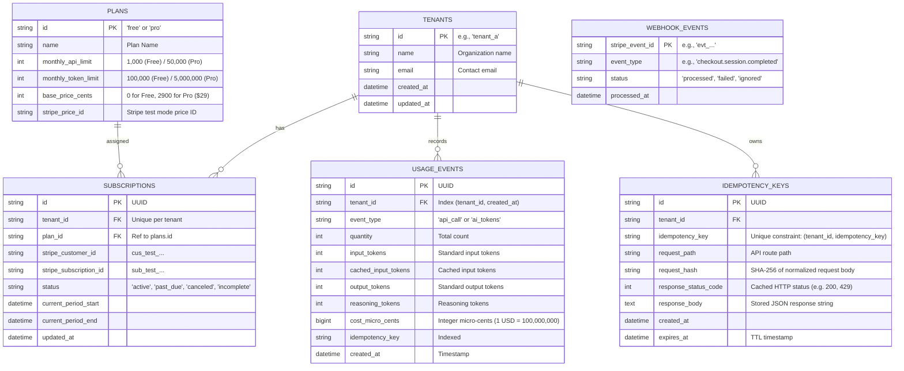

# Design Document: Usage Metering & Billing Engine

- **Author**: Antigravity & Engineer
- **Date**: 2026-10-20
- **Status**: Validated Design (Ready for Review & Planning)
- **Target Repo**: `llm-usage-metering-billing` (FlyRank Backend Track Capstone)

---

## 1. Executive Summary & Mission

Every SaaS product must reliably answer three fundamental questions:
1. **How much has this customer used?** (Usage Metering)
2. **How much should they pay?** (Money Math & Cost Calculation)
3. **Have they reached their plan limits?** (Quota Enforcement)

This service provides an idempotent, multi-tenant backend engine that meters billable events (API calls and simulated AI tokens), enforces plan quotas at strict numerical boundaries (yielding `429 Too Many Requests` or `402 Payment Required`), executes accurate integer-based token cost calculations, synchronizes subscription state via Stripe test mode webhooks with signature verification and replay protection, and runs a background reconciliation and quota alert worker.

---

## 2. Explicit Non-Goals (Scope Boundaries)

To ensure zero-risk correctness and respect capstone constraints:
- **No Real Payments or Live Mode**: The system operates strictly within Stripe Test Mode using test card numbers (e.g. `4242 4242 4242 4242`).
- **No Live External AI API Calls**: Token counts are metered and simulated via payload metadata; no external LLM API key or paid credit is required.
- **No Invoicing, Proration, or Overage Billing in Core**: Core focuses strictly on hard quotas and recurring plans (Free vs. Pro). Advanced invoicing and mid-cycle proration are deferred as optional post-core stretch goals.
- **No Floating-Point Math for Currency**: Money amounts are strictly stored and computed as integer units (cents and micro-cents).

---

## 3. Technology Stack & Runtime Architecture

- **Language & Runtime**: Python 3.11+
- **Web Framework**: FastAPI (asynchronous, auto-generating OpenAPI/Swagger UI at `/docs`)
- **Data Validation & Settings**: Pydantic v2 + Pydantic-Settings
- **ORM & Database Driver**: SQLAlchemy 2.0 (asyncio) + AsyncPG (PostgreSQL) / aiosqlite (SQLite fallback)
- **Migrations**: Alembic
- **Test Suite**: Pytest + pytest-asyncio + HTTPX
- **Database**: PostgreSQL (via Docker Compose) with automatic zero-configuration SQLite fallback for seamless single-command testing.
- **Stripe Tooling**: Stripe Python SDK (`stripe`) + Stripe CLI (`stripe listen`, `stripe trigger`)

### Layered Architecture Structure

```text
llm-usage-metering-billing/
├── config/
│   ├── settings.py               # Pydantic Settings (.env configuration & validation)
│   └── pricing.json              # Pinned pricing rules & plan constants
├── src/
│   ├── api/                      # Layer 1: HTTP Controllers & Boundary Validation
│   │   ├── deps.py               # Dependency Injection (DB session, Tenant context)
│   │   ├── error_handlers.py     # Global exception handlers (clean 4xx JSON, no 500 leaks)
│   │   └── v1/
│   │       ├── router.py         # Main v1 API router aggregation
│   │       ├── meter.py          # POST /api/v1/generate (Dummy billable endpoint)
│   │       ├── usage.py          # GET /api/v1/usage & GET /api/v1/tenants/{id}/usage
│   │       └── billing.py        # POST /api/v1/billing/checkout & /webhooks/stripe
│   ├── core/                     # Layer 2: Core Domain Logic & Calculations
│   │   ├── idempotency.py        # Request deduplication & cached response replay
│   │   ├── quota.py              # Boundary checker (429 quota vs 402 payment status)
│   │   ├── calculator.py         # Integer micro-unit money math & token pricing rules
│   │   └── stripe_service.py     # Stripe API client, webhook verification & subscription mapping
│   ├── db/                       # Layer 3: Persistence & Data Access
│   │   ├── session.py            # Engine & sessionmaker (PostgreSQL / SQLite auto-switch)
│   │   ├── models/               # SQLAlchemy models (Tenant, Plan, Subscription, UsageEvent, etc.)
│   │   └── repositories/         # Repositories for transactional ACID database operations
│   ├── workers/                  # Layer 4: Background Jobs (Requirement #3)
│   │   └── reconciliation.py     # Periodic Stripe subscription sync & quota alert evaluator
│   └── main.py                   # FastAPI application factory, lifespan, & middleware
├── migrations/                   # Alembic schema migrations
├── scripts/
│   └── seed.py                   # Demo data seeder (plans, tenants, baseline usage)
├── tests/                        # Acceptance probe test suite
├── docker-compose.yml            # PostgreSQL container definition
├── capstone.yaml                 # Evaluator manifest: run, seed, test, base_url
├── EVIDENCE.md                   # Pasted proof per acceptance requirement
├── BUILDLOG.md                   # AI usage log & engineering decision records
├── README.md                     # Comprehensive setup, architecture & limitations guide
└── .env.example                  # Safe configuration template
```

---

## 4. Data Model & Database Schema



---

## 5. Core Engine Specifications

### 5.1 Exactly-Once Metering & Idempotency Engine
- **Headers Required**: `X-Tenant-ID: <string>` and `Idempotency-Key: <string>`.
- **Deduplication Logic**:
  1. Inspect `IDEMPOTENCY_KEYS` table for `(tenant_id, idempotency_key)`.
  2. If found:
     - Verify SHA-256 hash of request payload against stored `request_hash`.
     - If hash differs: return `400 Bad Request` with message `"Idempotency-Key reused with different request payload"`.
     - If hash matches: return the previously stored status code, headers, and response body immediately. No usage event is created.
  3. If not found:
     - Run quota checks and billable action within a single database transaction.
     - Save response snapshot and status into `IDEMPOTENCY_KEYS`.
     - Return the freshly generated response.
- **Concurrency Safety**: Enforced via DB unique constraint `UNIQUE (tenant_id, idempotency_key)` and row-level locking to prevent race conditions during simultaneous identical requests.

### 5.2 Quota Enforcement & Boundary Honesty
- **Rule**: Check is evaluated *before* the billable action executes:
  $$\text{current\_monthly\_usage} + \text{requested\_quantity} \le \text{plan\_limit}$$
- **Boundary Behavior**:
  - Boundary: Free Plan limit = 1,000 API calls.
  - At 999 used: request requesting 1 call $\rightarrow$ **Allowed (200 OK)**. Usage becomes 1,000.
  - At 1,000 used: request requesting 1 call $\rightarrow$ **Blocked (429 Too Many Requests)**.
- **Status Code Demarcation**:
  - **`429 Too Many Requests`**: Used when the tenant has an active plan but has exceeded their allotted monthly usage quota. Returns `Retry-After: <seconds>` header and descriptive JSON error.
  - **`402 Payment Required`**: Used when the tenant's subscription status is not active (e.g. `past_due`, `canceled`, `unpaid`), informing the client that payment or card update is required before proceeding.

### 5.3 Cost Calculation & Token Pricing Rules
- **Rule 1**: Cached input tokens are priced at a discount compared to fresh input tokens.
- **Rule 2**: Reasoning tokens count and are priced as output tokens.
- **Rule 3**: Token categories are never summed indiscriminately; each is computed with its specific rate.
- **Formula**:
  $$\text{Cost} = (\text{fresh\_input} \times R_{\text{input}}) + (\text{cached\_input} \times R_{\text{cached}}) + ((\text{output} + \text{reasoning}) \times R_{\text{output}})$$
- **Precision**: Computed in integer **micro-cents** ($1\text{ USD} = 100\text{ cents} = 100,000,000\text{ micro-cents}$).
- **Pinned Rates (`config/pricing.json`)**:
  - Standard Input: $2.00 / 1M tokens ($200\text{ cents} / 1\text{M} = 200\text{ micro-cents/token}$)
  - Cached Input: $0.50 / 1M tokens ($50\text{ cents} / 1\text{M} = 50\text{ micro-cents/token}$, 75% discount)
  - Output Tokens: $8.00 / 1M tokens ($800\text{ cents} / 1\text{M} = 800\text{ micro-cents/token}$)
  - Reasoning Tokens: $8.00 / 1M tokens ($800\text{ cents} / 1\text{M} = 800\text{ micro-cents/token}$)

### 5.4 Stripe Test Mode Integration & Webhooks
- **Checkout (`POST /api/v1/billing/checkout`)**:
  - Creates a Stripe Checkout Session in subscription mode with `client_reference_id = tenant_id`.
  - Returns `checkout_url` and `session_id`.
- **Webhook Endpoint (`POST /api/v1/billing/webhooks/stripe`)**:
  - Uses raw request byte payload and `Stripe-Signature` header with `stripe.Webhook.construct_event`.
  - Forged signatures or missing headers $\rightarrow$ immediate `400 Bad Request` with no state modification.
  - Replay deduplication: Checks `WEBHOOK_EVENTS` for `stripe_event_id`. If already present $\rightarrow$ returns `200 OK` with `{"status": "ignored", "reason": "duplicate_event"}`.
  - Event Handlers:
    - `checkout.session.completed`: Sets tenant's plan to `pro`, status to `active`, records Stripe customer & subscription IDs.
    - `customer.subscription.updated`: Updates subscription status (`active`, `past_due`, etc.).
    - `customer.subscription.deleted`: Reverts tenant to `free` plan.

### 5.5 Background Job: Stripe Reconciliation & Quota Alerts
- **Worker Script / Background Task**: `src/workers/reconciliation.py`.
- **Responsibilities**:
  1. **Reconciliation**: Periodically queries tenants with active Stripe subscriptions, calls Stripe API to cross-verify subscription state, and reconciles any discrepancies caused by missed webhooks.
  2. **Quota Alerting**: Checks current cycle usage against plan limits. Emits structured log alerts at $\ge 80\%$ and $\ge 100\%$ thresholds.
  3. **Resilience**: Implements exponential backoff retries on network failures and logs failure alerts if retries are exhausted.

---

## 6. API Interface Contracts

### 1. `POST /api/v1/generate` (Billable Endpoint)
- **Headers**:
  - `X-Tenant-ID: tenant_a` (Required)
  - `Idempotency-Key: req_abc123` (Required)
- **Request Body**:
  ```json
  {
    "model": "gemini-1.5-pro",
    "prompt": "Summarize this quarterly report",
    "simulated_tokens": {
      "input_tokens": 1000,
      "cached_input_tokens": 500,
      "output_tokens": 400,
      "reasoning_tokens": 100
    }
  }
  ```
- **Success Response (200 OK)**:
  ```json
  {
    "id": "evt_019283aa-8812-70b1-bce2-6412e8b091f0",
    "tenant_id": "tenant_a",
    "status": "success",
    "result": "Simulated AI generation output text.",
    "usage": {
      "api_calls": 1,
      "input_tokens": 1000,
      "cached_input_tokens": 500,
      "output_tokens": 400,
      "reasoning_tokens": 100,
      "total_tokens": 2000
    },
    "cost": {
      "micro_cents": 625000,
      "cents": 0.625,
      "formatted": "$0.00625"
    }
  }
  ```
- **Error Response (429 Too Many Requests)**:
  ```json
  {
    "error": {
      "code": "quota_exceeded",
      "message": "Monthly API call limit reached for Free plan (1000/1000). Upgrade to Pro to continue.",
      "metric": "api_calls",
      "current_usage": 1000,
      "limit": 1000,
      "plan": "free"
    }
  }
  ```

### 2. `GET /api/v1/tenants/{tenant_id}/usage` (Rollup Endpoint)
- **Response (200 OK)**:
  ```json
  {
    "tenant_id": "tenant_a",
    "period": "2026-10",
    "plan": {
      "id": "pro",
      "name": "Pro Plan",
      "base_price_cents": 2900
    },
    "subscription_status": "active",
    "usage": {
      "api_calls": {
        "used": 150,
        "limit": 50000,
        "percent_used": 0.3
      },
      "tokens": {
        "total_used": 125000,
        "limit": 5000000,
        "percent_used": 2.5,
        "breakdown": {
          "standard_input": 50000,
          "cached_input": 25000,
          "standard_output": 40000,
          "reasoning": 10000
        }
      }
    },
    "cost": {
      "token_cost_micro_cents": 51250000,
      "token_cost_cents": 51,
      "base_subscription_cents": 2900,
      "total_cents": 2951,
      "formatted": "$29.51"
    }
  }
  ```

### 3. `POST /api/v1/billing/checkout`
- **Request Body**:
  ```json
  {
    "tenant_id": "tenant_a",
    "plan_id": "pro"
  }
  ```
- **Response (200 OK)**:
  ```json
  {
    "checkout_url": "https://checkout.stripe.com/c/pay/cs_test_a1b2c3...",
    "session_id": "cs_test_a1b2c3..."
  }
  ```

### 4. `POST /api/v1/billing/webhooks/stripe`
- **Headers**: `Stripe-Signature: t=...,v1=...`
- **Body**: Raw binary Stripe event payload.
- **Responses**:
  - `200 OK`: `{"status": "success", "event_id": "evt_..."}` or `{"status": "ignored", "reason": "duplicate_event"}`
  - `400 Bad Request`: `{"error": "Invalid signature"}` or `{"error": "Invalid payload"}`

---

## 7. Acceptance Probes & Verification Matrix

| Probe | Requirement Checked | Verification Test File |
|---|---|---|
| **PROBE 1** | Exactly-once metering via idempotency key (same key $\rightarrow$ 1 event, identical response) | `tests/test_idempotency.py` |
| **PROBE 2** | Quota boundary honesty: at 1,000/1,000 $\rightarrow$ 200 OK, at 1,001 $\rightarrow$ 429 Too Many Requests; inactive plan $\rightarrow$ 402 Payment Required | `tests/test_quotas.py` |
| **PROBE 3** | Stripe Checkout test completion $\rightarrow$ webhook flips tenant Free $\rightarrow$ Pro; `/usage` limits updated | `tests/test_stripe_webhooks.py` |
| **PROBE 4** | Webhook forged signature $\rightarrow$ 400 Bad Request; Webhook replay twice $\rightarrow$ processed once | `tests/test_stripe_webhooks.py` |
| **PROBE 5** | AI token pricing: cached-input 75% discount, reasoning tokens billed as output, rollup matches pinned constants | `tests/test_pricing.py` |
| **REQ #3** | Background worker reconciliation & quota alert detection with retries | `tests/test_worker.py` |

---

## 8. Submission Artifacts

1. **`capstone.yaml`**: Standard manifest with `run:`, `seed:`, `test:`, and endpoints list.
2. **`EVIDENCE.md`**: Direct terminal transcripts and test execution proofs for each probe and requirement.
3. **`BUILDLOG.md`**: Transparent log of design choices, AI pairing iterations, and debugging steps.
4. **`README.md`**: Architectural diagram, quickstart setup, Stripe CLI testing guide, and documented limitations.
5. **`.env.example`**: Safe environment variable template.
